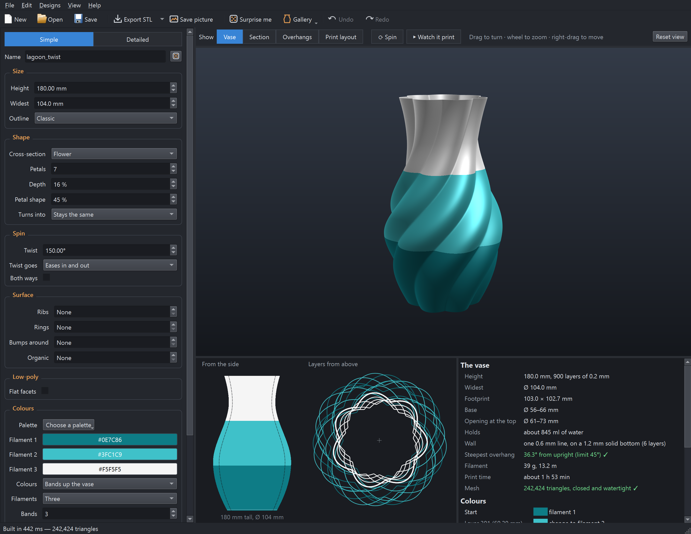
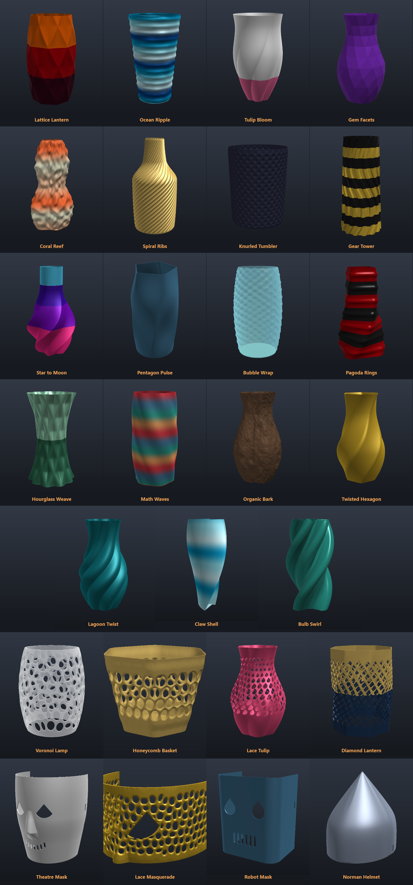
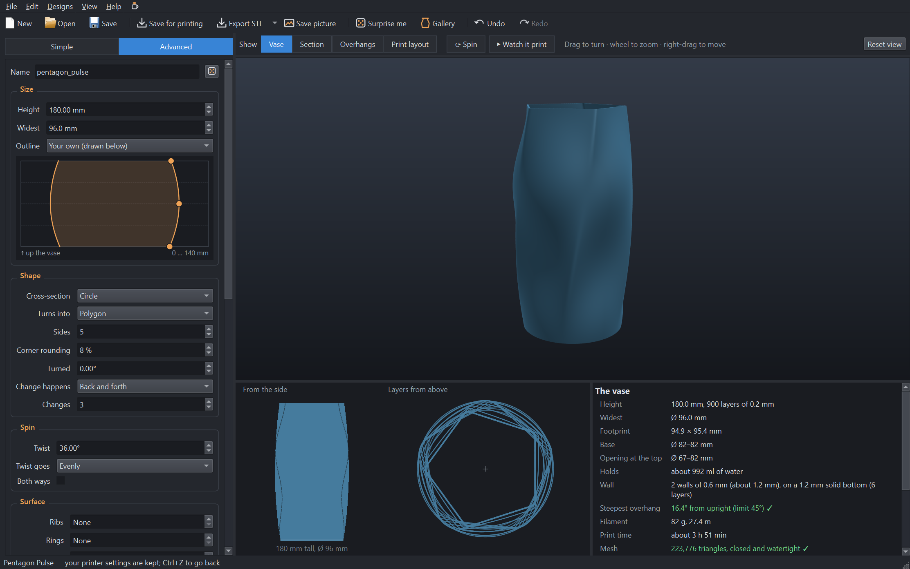
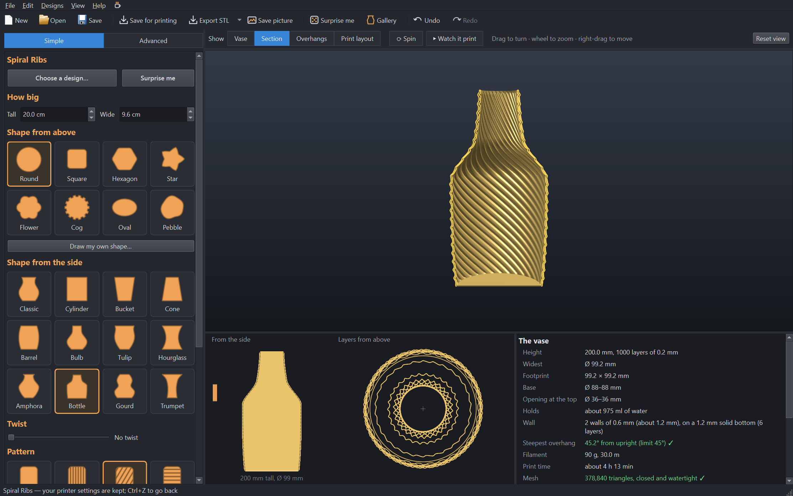
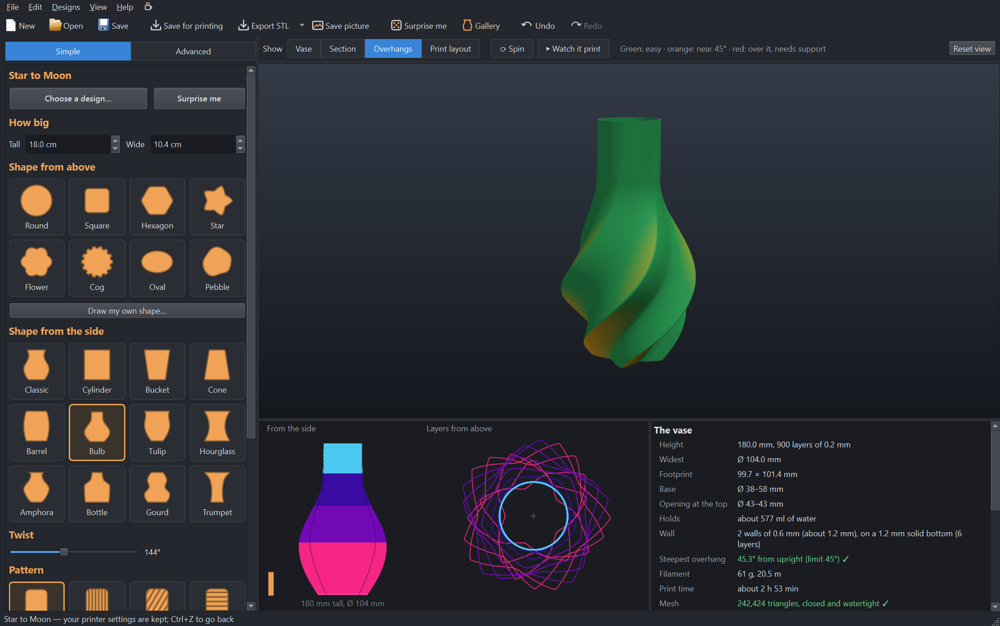
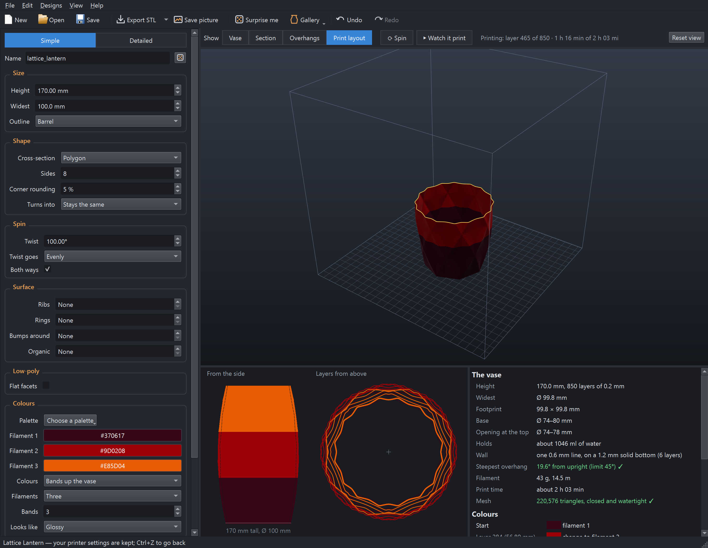
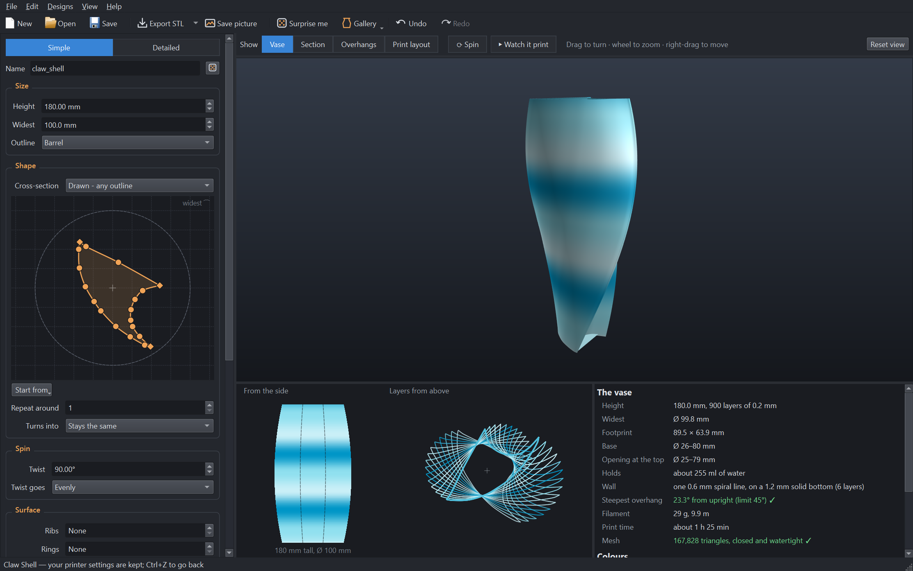
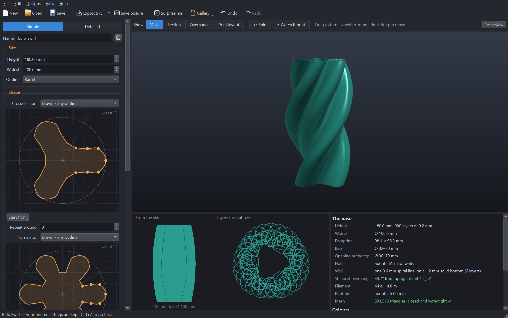

# Vaseinator

A Windows desktop app that designs **vases for a 3D printer's spiral vase mode**: one continuous wall
climbing round and round on a solid bottom. Every vase it makes is a closed, watertight model, every
layer is one single loop, and no part of the wall leans further than you allow – so it **prints
without supports**.

Shape the outline, pick a cross-section and what it turns into on the way up, **spin** it, cover it in
ribs, rings, bumps, organic lumps or **your own formula**, and colour it in bands, stripes or a
gradient spool. The app shows the vase in 3D as it will print, cuts it in half to show the wall, colours
every face by how far it leans, plays the print back in real print time, and exports an STL or 3MF
ready to slice.





| Draw how things change up the vase | Section: the single printed wall |
|---|---|
|  |  |
| **Overhangs: green is easy, red needs support** | **Watch it print, in real print time** |
|  |  |
| **Draw any cross-section, sharp corners and all** | **Draw one lobe, repeat it: three bulbs become six** |
|  |  |

## Features

* **Outline** from twelve presets (classic, bulb, tulip, amphora, bottle, gourd, trumpet, …) or drawn
  by hand: drag points on the outline curve; the curve through them never overshoots.
* **Cross-section**: circle, polygon (with rounded corners), star, flower, gear, ellipse or pebble – and
  a second shape it **turns into** on the way up – evenly, early, late, **back and forth** as many times
  as you like (circle → pentagon → circle → pentagon), or along your own curve.
* **Draw any cross-section**: a spline editor with smooth points and sharp **cusps**, for shapes no
  formula makes – lobes that swell past their necks, a crescent, a claw, a heart, nothing symmetrical at
  all. Draw one lobe and **repeat it around**, start from a built-in shape, or **trace a picture**.
* **Spin**: twist the shape round as it rises – evenly, easing in and out, speeding up, slowing down,
  **back and forth**, or along your own curve – or **both ways at once** for a lattice of crossing ridges.
* **Surface patterns**: ribs (that can spiral, or cross for diamond knurling), rings, staggered bumps
  and smooth organic lumps, each with its own depth and shape, a strength that can change up the vase,
  and a plain foot and rim.
* **Low-poly facets**: the whole vase from flat triangles, like a cut gem, with an optional rough cut.
* **Your own function**: type a formula in millimetres – `1.5 * sin(6*theta + 4*pi*h)` – added to the
  radius everywhere. Variables for the angle, the angle turning with the twist, height, share of the
  height and the radius so far; trig, waves, steps and smooth noise. It is checked and run safely:
  numbers, the listed variables and functions only.
* **Real or fake spiral vase**: a *real* one prints in the slicer's spiral vase mode – one continuous
  line, fast and clean, in one filament (or a gradient spool). A *fake* one is an ordinary print of a
  hollow vase – a few walls, no infill, no top – slower, but sturdier and in colour.
* **Colours**: one colour or a **gradient spool** – shown where its colours will really land, worked out
  from the filament each height uses – and, for a fake spiral vase, up to four filaments in **bands**
  (even, or thicker at the top or the bottom) or **stripes**, with palettes.
* **Looks**: matte, silk, glossy or translucent in the 3D view.
* **Printable, always**: a spiral wall rests on the single line below it, so it may lean neither out nor
  in further than the limit (45° by default). **Soften to fit** reshapes only what leans too far – and
  tells you by how much – and every triangle is checked afterwards.
* **Views**: the vase, a **section** through the printed wall, an **overhang check**, and the print
  layout on your bed inside the printer's build volume. **Spin** turns it on a turntable; **Watch it
  print** builds it up in real print time (wide layers take longer).
* **The sums**: size, base and opening, how much water it holds, filament in grams and metres, print
  time, steepest overhang, and the mesh – closed and watertight.
* **Gallery** of nineteen ready-made vases, **Surprise me** (a new random vase that still prints), and
  **undo / redo** of everything.
* Exports a solid **STL**, or a **3MF** in the middle of the bed – one solid for a real spiral vase, each
  colour band its own part, set to its filament, for a fake one – as Lenticular Sign Maker and Maze Tube
  Designer do. Designs save as `.vase` files (JSON).
* **Simple** shows the essentials; **Detailed** shows every setting and the curves.

## Download and run

* **Windows app (no Python needed):** download `Vaseinator.exe` from the
  [Releases](../../releases) page and run it. It is a single file: nothing to unzip or install.
  It isn't code-signed, so Windows SmartScreen may ask once; choose **More info → Run anyway**.
* **From source** (Python 3.10+, any OS with OpenGL):
  ```
  git clone https://github.com/RickUsingGitHub/vaseinator.git
  cd vaseinator
  python -m venv .venv
  .venv\Scripts\pip install -r requirements.txt      # macOS/Linux: .venv/bin/pip
  .venv\Scripts\python main.py
  ```
  On Windows you can also just double-click `run.bat`, which sets everything up on first run.
* **Build the Windows app yourself:** `build_exe.bat` (uses PyInstaller; the result is
  `dist\Vaseinator.exe`).

`examples\` holds the gallery as `.vase` designs to open. `tools\make_examples.py` writes them again, and
six of them to `examples\stl\` as finished STLs, checked and ready to slice: Lagoon Twist, Star to Moon,
Lattice Lantern, Gem Facets, Coral Reef and Claw Shell. (STLs are big, so they are not kept in git.)

On first run the app borrows your printer's bed size and height from Maze Tube Designer or Lenticular
Sign Maker, if you have used them. Printer settings are remembered for new designs.

## Using it

Pick a vase from the **Gallery** or press **Surprise me**, then change it. Every change rebuilds the vase
at once; while you drag a point on a curve, a quicker rough version follows your hand.

The curves for the twist, the change of shape and the pattern strength are ordinary graphs: the vase
from bottom to top runs left to right, and the value runs up – drag a point up for more, down for
less. Double-click to add a point (a few make a wave), right-click to take one away. The outline's
curve is drawn upright and mirrored instead, like the vase from the side.

| Group | What it does |
| --- | --- |
| **Size** | Height, the widest diameter (scales the whole outline), and the outline: a preset, or your own curve – diameter at each height, drawn as the vase seen from the side. |
| **Shape** | The cross-section at the bottom, and what it turns into at the top. Each shape has its own settings: sides, points, petals or teeth; how deep it cuts in; how sharp it is; how far it is turned. **Drawn – any outline** gives you the cross-section editor instead (below). **Change happens** says how the first shape becomes the second on the way up – including back and forth, as many **Changes** as you like, and your own curve. |
| **Spin** | How far the shape turns from bottom to top, and how the turning is spread up the vase – including back and forth, and your own curve. **Both ways** twists it both ways at once. |
| **Surface** | Ribs, rings, bumps and organic lumps; whether they turn with the twist; how strong they are up the vase; and a plain foot and rim. |
| **Low-poly** | Flat facets: how many round and up, and how rough the cut. |
| **Your own function** | A formula added to the radius. **Examples** has eight to try; **Help…** lists the variables and functions. |
| **Colours** | **Vase mode**: real spiral vase (one colour, or a gradient spool) or fake spiral vase (colours). The colour, or – for a fake spiral vase – a palette or four filament colours, and how they go up the vase: one colour, bands, stripes or a gradient spool. How it looks: matte, silk, glossy, translucent. |
| **Printing** | For a fake spiral vase, how many **walls**. The steepest overhang allowed and **Soften to fit**; the line width and layer height; the solid bottom; the printer's height and bed; speed and flow (for the print time); filament diameter and density (for the weight); and the mesh detail. |

**3D view:** left-drag turns it, right-drag or shift-drag moves it, the wheel zooms, double-click or F goes
back to the chosen view. **S** spins it, **F5** watches it print, **Ctrl+1–4** switch views, **Ctrl+R**
is Surprise me, **Ctrl+Z / Ctrl+Y** undo and redo.

**Drawing a cross-section:** the middle of the editor is the vase's axis and the dashed circle its widest
(the outline is scaled so its furthest point touches it). Drag a point; double-click the line to add one,
and double-click a point to switch it between smooth (a circle) and a sharp corner (a diamond);
right-click a point to take it away. **Repeat around** copies what you draw round the axis – draw one lobe,
get five. **Start from** has ready-made outlines – a claw, bulbs, a heart – and **Trace a
picture…** (a dark closed line or filled shape on a light ground). Switching a built-in shape to Drawn
starts from it: a five-petalled flower becomes one petal, repeated five times. Twist, the change into a
second shape, the patterns and colour bands all work on a drawn outline; it turns red if it crosses itself.

Under the 3D view, **From the side** shows the outline in the colour of each height (the dashed line is
the narrowest radius, so you can see how deep the shape goes; an orange tick on the left marks heights
that were softened, a red tick on the right anything still leaning too far), and **Layers from above**
shows fifteen layers stacked, so the twist and the change of shape are easy to see.

## Printing

Choose the **Vase mode** under *Colours* first.

**A real spiral vase**

* **Slice with spiral vase mode on** (Spiralize). The exported model is **solid**: the slicer prints only
  its outside, as one continuous line. Don't slice it normally with infill – it would print as a solid
  block.
* Set **bottom layers** to the number the panel gives (6 for a 1.2 mm bottom at 0.2 mm layers), **0 top
  layers**, 0% infill, 1 wall.
* Set the **outer wall line width** to the app's line width. 0.6–0.8 mm on a 0.4 mm nozzle is much
  stronger and more watertight than 0.4 mm.
* It prints **one filament**. Flash Studio won't change filament in spiral vase mode (*Change Filament* is
  greyed out on the layer slider), and won't spiral an object made of parts of several filaments. A
  gradient spool is one filament, so it works.

**A fake spiral vase**

* Leave spiral vase mode **off**. Set the **walls** (wall loops) the app is set to – two make a sturdy,
  watertight vase – **0% sparse infill**, **0 top layers**, and the bottom layers the panel gives.
* The colour bands and stripes are parts of their own filaments in the 3MF, so the slicer prints them in
  colour by itself; on a printer with several toolheads, like the Creator 5 Pro, each band uses its own
  head. It prints a layer at a time, so it is slower than a spiral, with a seam.

**Either way**

* **No supports.** The panel shows the steepest lean of the wall; the Overhangs view shows where it is.
* **To make sure it holds water:** a little extra flow (103–105%), 5–10 °C hotter than usual for strong
  layer bonds, and a moderate speed (30–50 mm/s for the wall). PETG is more watertight than PLA; silk PLA
  looks lovely but bonds a little less well. Test it in a sink. A coat of clear epoxy or varnish inside
  seals any weep.
* A **brim** helps a vase with a narrow foot stay put.

`tools\verify_stl.py` checks any STL for spiral vase printing, straight from the file: closed and
watertight, faces outwards, one piece, flat on the bed, no wall leaning past the limit, and every layer
one closed loop.

```
.venv\Scripts\python tools\verify_stl.py examples\stl\lagoon_twist_vase.stl
```

## Opening the 3MF in your slicer

**Export 3MF** writes the vase as one object in the middle of the bed – the same kind of file as Lenticular
Sign Maker and Maze Tube Designer. In **Flash Studio or OrcaSlicer**, use **File ▸ Import** (Ctrl+I).

* **Real spiral vase:** the vase is one solid part. Turn on spiral vase mode and print.
* **Fake spiral vase:** each colour band is its own part, set to filaments 1, 2, 3… in the vase's colours;
  reassign them in the slicer as you like. Leave spiral vase mode off, set the walls, 0% infill and 0 top
  layers, and print.

## Project layout

| File | What it holds |
| --- | --- |
| `main.py` | Starts the app. |
| `vaseinator/app.py` | The main window: settings panel, views, animations, gallery, undo, exports. |
| `vaseinator/geometry.py` | The vase itself: the surface, softening, the solid and the shown shell, and the sums. |
| `vaseinator/shapes.py` | Outlines, cross-sections, curves up the height, textures, palettes. |
| `vaseinator/expr.py` | Your own function: checked, then evaluated with numpy. |
| `vaseinator/sections.py` | Drawn cross-sections: the spline through the points, tracing a picture, filling and insetting outlines. |
| `vaseinator/curves.py` | The curve editor. |
| `vaseinator/outline_editor.py` | The cross-section editor. |
| `vaseinator/plots.py` | The side and from-above pictures. |
| `vaseinator/viewer.py` | The OpenGL 3D view. |
| `vaseinator/presets.py` | The gallery and Surprise me. |
| `vaseinator/params.py` | Settings, and saving and opening designs. |
| `vaseinator/stl.py`, `threemf.py` | The exports. |
| `tests/test_vase.py`, `tests/test_app.py` | Self-tests of the geometry and the window. |
| `tools/` | The icon, the example files, and the STL checker. |

### How the geometry works

The vase is a radial height map r(θ, z): one radius in each direction round the axis at each height,
built on a grid of heights and angles. Because each height has exactly one radius in each direction,
every layer is one simple closed loop – what spiral vase mode needs – and the mesh can't cross itself:
each triangle lies in its own wedge of angle between two heights. The wall is joined to a flat bottom
and a flat top, so the solid is closed, watertight and one piece, with no boolean operations.

A **drawn** cross-section needn't have one radius in each direction – a lobe can swell past its neck – so
it is built another way: as rows of points up the vase, each row the outline (blended into the second
one, sized by the outline curve and turned by the twist) cut into the same number of points at even
distances along it, the patterns pushed out square to it. Neighbouring rows join point to point, the
bottom and top are filled by ear clipping, and any outline that crosses itself is refused, so every layer
is still one simple loop. Softening limits how fast the size, the twist and the change of shape may go at
any height where a face leans too far, and fades the patterns there gently.

Shapes are smoothed to the grid's own spacing, so sharp points and valleys that twist across it don't
alias into rows of little teeth.

How far the wall leans is measured on the true surface normal: tan(lean) = r·|∂r/∂z| / √(r² + (∂r/∂θ)²),
out or in alike. **Soften to fit** works in two steps. A shape twisting faster than its flanks can follow
first has its flanks softened round each layer (a flank carried sideways at r·ω leans by
r·ω·|r_θ| / √(r² + r_θ²)), so it stays one clean twisted shape. Then each column up the vase is limited to
the slope the lean allows there – the largest surface under it and the smallest over it that keep within
the limit, averaged – with the correction smoothed round the vase so neighbouring columns agree. Every
finished triangle is then checked, and the limit tightened just round any that still lean too far.

`.venv\Scripts\python -m tests.test_vase` builds every gallery vase, a dozen surprises and some hard
cases – drawn outlines among them – and checks that each is closed and watertight with outward faces, flat on the bed, within the
overhang limit, and one closed loop at every height tested; that leans are measured right; that a
cylinder has the right volume and capacity; that STL and 3MF files read back the same; that designs save
and open; that your own function can reach nothing it shouldn't; that colour changes land on layers; and
that a drawn outline goes through its points, matches the built-in shape it came from, holds what a round
vase holds, is refused if it crosses itself, and can be traced from a picture.
`.venv\Scripts\python -m tests.test_app` drives the window itself: edits, curves, undo, the gallery,
Surprise me, every view, the print animation, saving and exporting, and drawing, repeating and tracing a
cross-section. Test windows open on the second
screen, if there is one.

## License

MIT – see [LICENSE](LICENSE).
